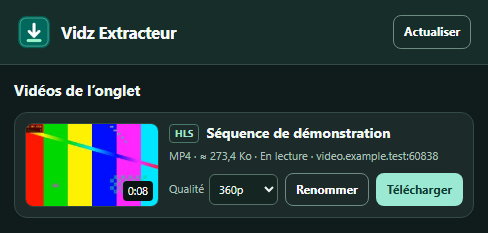

<table width="100%">
  <tr>
    <td width="300" align="left" valign="top">
      <a href="https://github.com/MrMybal/VidzExtractor">Dépôt</a><br>
      <a href="https://github.com/MrMybal/VidzExtractor/issues">Problèmes</a><br><br>
      <sub>README</sub><br>
      <a href="README.md">English</a> · <a href="README.fr.md">Français</a>
    </td>
    <td width="400" align="center" valign="middle">
      
    </td>
    <td width="300" align="right" valign="top">
      <p><sub>Licence de l’application</sub><br><a href="LICENSE"><strong>GPL-3.0-only</strong></a></p>
      <p><sub>Version</sub><br><a href="VERSION.fr.md"><strong>1.2.0</strong></a></p>
      <p><a href="https://github.com/MrMybal/VidzExtractor/releases/download/v1.2.0/VidzExtractor-Chrome-1.2.0.zip"><strong>ZIP Chrome</strong></a><br><a href="https://github.com/MrMybal/VidzExtractor/releases/download/v1.2.0/VidzExtractor-Firefox-1.2.0.xpi"><strong>XPI Firefox</strong></a></p>
    </td>
  </tr>
</table>

<h1 align="center">Vidz Extracteur</h1>

Vidz Extracteur est une extension Chrome et Firefox qui enregistre les vidéos détectées dans l’onglet courant. Elle gère les fichiers directs comme MP4 et WebM ainsi que les flux HLS à la demande non chiffrés, avec les pistes audio et vidéo regroupées. L’interface est en français.

> **Version 1.2.0**
>
> Cette release ajoute une édition Firefox. Les deux éditions affichent un aperçu, la durée, la taille lorsqu’elle est disponible et un choix de qualité pour les flux HLS compatibles. Consulte les [notes de version et les limites connues](VERSION.fr.md).

[](assets/screenshots/vidz-extracteur-hls.png)

## Fonctionnement

Lance une vidéo et ouvre Vidz Extracteur depuis la barre d’outils du navigateur. La fiche affiche une image de la vidéo ou son affiche quand le navigateur y donne accès. Une taille précédée de `≈` est estimée à partir du débit annoncé ou d’un échantillon de segments.

Utilise **Renommer** pour modifier le nom proposé et **Télécharger** pour enregistrer la vidéo. Le navigateur gère les téléchargements directs. En HLS, choisis une **Qualité** si le flux en propose plusieurs, puis clique sur **Enregistrer la vidéo** dans l’onglet d’export. Garde cet onglet ouvert jusqu’à la fin de l’enregistrement. Le format dépend des segments d’origine, en MPEG-TS ou MP4 fragmenté. Firefox suit tes préférences d’emplacement de téléchargement.

L’extension observe les requêtes vidéo et les lecteurs de l’onglet. La liste des détections reste dans la session du navigateur et s’efface lors d’une navigation complète ou à la fermeture de l’onglet. L’extension n’envoie aucune télémétrie.

---

## Installation

### Chrome

1. [Télécharge le ZIP Chrome](https://github.com/MrMybal/VidzExtractor/releases/download/v1.2.0/VidzExtractor-Chrome-1.2.0.zip) et extrais-le.
2. Ouvre `chrome://extensions`, active **Mode développeur**, puis clique sur **Charger l’extension non empaquetée**.
3. Sélectionne le dossier extrait qui contient `manifest.json`. Épingle **Vidz Extracteur** depuis le menu des extensions de Chrome.
4. Lance une vidéo et ouvre l’extension. Si la page était déjà ouverte à l’installation et que la liste est vide, recharge-la.

Après une mise à jour des fichiers, clique sur l’icône de rechargement de Vidz Extracteur dans `chrome://extensions`, puis recharge la page de la vidéo.

### Firefox 140 ou version ultérieure

1. [Télécharge le XPI Firefox](https://github.com/MrMybal/VidzExtractor/releases/download/v1.2.0/VidzExtractor-Firefox-1.2.0.xpi).
2. Ouvre `about:debugging#/runtime/this-firefox` et clique sur **Charger un module complémentaire temporaire…**.
3. Sélectionne le XPI et ouvre Vidz Extracteur depuis le menu des extensions. Si la fenêtre attend un manifeste, extrais le XPI comme un ZIP puis sélectionne `manifest.json` dans le dossier extrait.

Le XPI est non signé et reste chargé jusqu’au redémarrage de Firefox. Une installation permanente sur Firefox Release nécessite une signature Mozilla.

## Sources et prérequis

```sh
git clone https://github.com/MrMybal/VidzExtractor.git
cd VidzExtractor
python scripts/package.py
```

Chrome peut charger directement la racine du dépôt. Le script Python 3 génère le ZIP Chrome et le XPI Firefox dans `dist/` à partir des fichiers partagés et applique les réglages du manifeste Firefox. Les deux éditions utilisent les API intégrées au navigateur et fonctionnent sans logiciel compagnon ni bibliothèque tierce à l’exécution.

---

## Licence

Vidz Extracteur est distribué sous la [licence publique générale GNU, version 3 uniquement](LICENSE) (`GPL-3.0-only`).

## Références

- [Notes de version](VERSION.fr.md)
- [Releases GitHub](https://github.com/MrMybal/VidzExtractor/releases)
- [Signaler un problème](https://github.com/MrMybal/VidzExtractor/issues)
