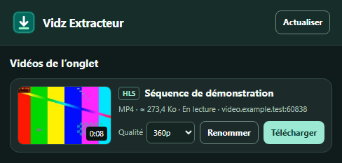

<table width="100%">
  <tr>
    <td width="300" align="left" valign="top">
      <a href="https://github.com/MrMybal/VidzExtractor">Repository</a><br>
      <a href="https://github.com/MrMybal/VidzExtractor/issues">Issues</a><br><br>
      <sub>README</sub><br>
      <a href="README.md">English</a> · <a href="README.fr.md">Français</a>
    </td>
    <td width="400" align="center" valign="middle">
      
    </td>
    <td width="300" align="right" valign="top">
      <p><sub>Application license</sub><br><a href="LICENSE"><strong>GPL-3.0-only</strong></a></p>
      <p><sub>Version</sub><br><a href="VERSION.md"><strong>1.2.0</strong></a></p>
      <p><a href="https://github.com/MrMybal/VidzExtractor/releases/download/v1.2.0/VidzExtractor-Chrome-1.2.0.zip"><strong>Chrome ZIP</strong></a><br><a href="https://github.com/MrMybal/VidzExtractor/releases/download/v1.2.0/VidzExtractor-Firefox-1.2.0.xpi"><strong>Firefox XPI</strong></a></p>
    </td>
  </tr>
</table>

<h1 align="center">Vidz Extracteur</h1>

Vidz Extracteur is a Chrome and Firefox extension for saving videos detected in the current tab. It works with direct files such as MP4 and WebM and supports unencrypted, on-demand HLS with combined audio and video tracks. The extension interface is in French.

> **Version 1.2.0**
>
> This release adds a Firefox edition. Both editions offer a preview, duration, file size when available, and a quality selector for compatible HLS streams. See the [version notes and known limitations](VERSION.md).

[](assets/screenshots/vidz-extracteur-hls.png)

## How it works

Start a video and open Vidz Extracteur from the browser toolbar. The card shows a frame or poster when the browser can access it. A size prefixed with `≈` is an estimate based on the declared bitrate or a sample of segments.

Use **Renommer** to change the suggested filename and **Télécharger** to save the video. The browser handles direct file downloads. For HLS, select a **Qualité** when the stream offers a choice, then click **Enregistrer la vidéo** in the export tab. Keep that tab open until the save completes. The original segments determine the output format, either MPEG-TS or fragmented MP4. Firefox follows your browser's download location preference.

The extension checks the media requests and players in the tab. Its detection list lives in the browser session and clears on full page navigation or when the tab closes. The extension sends no telemetry.

---

## Installation

### Chrome

1. [Download the Chrome ZIP](https://github.com/MrMybal/VidzExtractor/releases/download/v1.2.0/VidzExtractor-Chrome-1.2.0.zip) and extract it.
2. Open `chrome://extensions`, turn on **Developer mode**, and click **Load unpacked**.
3. Select the extracted folder that contains `manifest.json`. Pin **Vidz Extracteur** from Chrome's extensions menu.
4. Start a video and open the extension. Reload any video page that was already open at installation if the media list is empty.

After updating the files, click **Reload** on the Vidz Extracteur card in `chrome://extensions` and reload the video page.

### Firefox 140 or later

1. [Download the Firefox XPI](https://github.com/MrMybal/VidzExtractor/releases/download/v1.2.0/VidzExtractor-Firefox-1.2.0.xpi).
2. Open `about:debugging#/runtime/this-firefox` and click **Load Temporary Add-on…**.
3. Select the XPI and open Vidz Extracteur from the extensions menu. If the picker needs a manifest, extract the XPI as a ZIP and select `manifest.json` in the extracted folder.

The XPI is unsigned and stays loaded until Firefox restarts. A permanent installation on Firefox Release requires a Mozilla signature.

## Source and requirements

```sh
git clone https://github.com/MrMybal/VidzExtractor.git
cd VidzExtractor
python scripts/package.py
```

Chrome can load the checkout root directly. The Python 3 script builds the Chrome ZIP and Firefox XPI in `dist/` from the shared files and applies the Firefox manifest overrides. Both editions use the browser's built-in APIs and work without third-party runtime libraries or a companion app.

---

## License

Vidz Extracteur is licensed under the [GNU General Public License, version 3 only](LICENSE) (`GPL-3.0-only`).

## References

- [Version notes](VERSION.md)
- [GitHub releases](https://github.com/MrMybal/VidzExtractor/releases)
- [Report an issue](https://github.com/MrMybal/VidzExtractor/issues)
